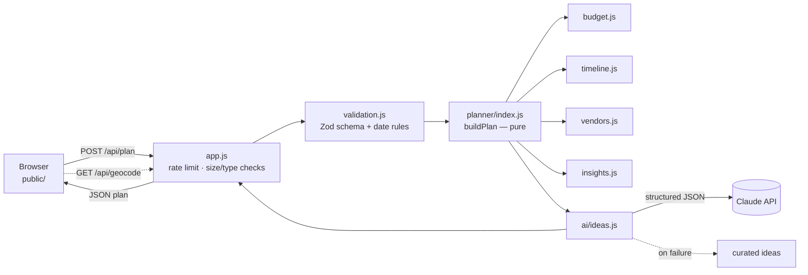

# Plan Together: GenAI Event Planning Assistant

[](https://github.com/seeramsujay/event-manager/actions/workflows/ci.yml)


An assistant that helps people organize **weddings, birthdays and community events**. You describe your event (date, guests, budget, location, setting, style, priorities and needs) and it builds a plan with:

| Part of the plan | What you get |
|---|---|
| 🌟 **Landing page & smooth scroll** | Clean hero introduction with key value propositions and a smooth-scroll CTA button to the planner form |
| ♿ **Accessibility toolbar** | Expandable preferences toolbar for font size (Large), high-contrast mode (WCAG AAA), and forced reduced motion |
| 💰 **Budget breakdown** | Category amounts that add up exactly to your budget, shifted toward what you care about most |
| 🗓️ **Timeline** | Tasks scheduled backwards from your date. If you have less time than usual, the whole schedule is compressed to fit |
| ✅ **Vendor checklist** | What to book, how important it is, the date to book it by and a practical tip. Ticks are saved in your browser |
| ⚠️ **Context-aware insights** | Warnings and tips for rushed timelines, tight budgets, location & weather, crowds, kids, milestone birthdays and accessibility |
| ✨ **Personalized ideas** | Themes, decor, food, activities and budget tips from Claude, grounded in your plan and location. Curated ideas are used as a fallback |
| 📍 **Location detection** | One-click browser geolocation button to automatically detect your local city or region via privacy-preserving reverse geocoding |
| 📄 **Take it with you** | Download the whole plan as a text file to share with co-hosts, or print it |

---

## Contents

1. [Chosen vertical](#chosen-vertical)
2. [Approach and logic](#approach-and-logic)
3. [How it works](#how-it-works)
4. [Getting started](#getting-started)
5. [Configuration](#configuration)
6. [Quality: security, testing, accessibility, efficiency](#quality)
7. [Assumptions](#assumptions)
8. [Further documentation](#further-documentation)

---

## Chosen vertical

**Event planning assistant.** The persona is a host or organizer: a couple, a parent, a friend or a community volunteer. They are not a professional planner. They need a realistic plan they can act on, and it has to fit their budget and the time they have left. Three event types are supported, each with its own budgeting, timeline, vendor and idea knowledge.

## Approach and logic

The design is a hybrid: **deterministic rules for decisions, GenAI for creativity.**

| Concern | Who decides | Why |
|---|---|---|
| Budget amounts, deadlines, vendor importance, risks | **Rules engine** (`src/planner/`) | Must be exact, explainable and testable: money has to add up, and permits and weather plans must never be forgotten |
| Themes, decor, food, activities, personal touches | **Claude** (`src/ai/ideas.js`) | Open-ended and creative, and benefits from the user's own words and geographic context |

The LLM receives the engine's results (budget tier, top categories, key risks, location) as grounding context, so its ideas match the plan. As a result:

- The plan is **always available**, fast and free, even with no API key or when the AI is down.
- Every number and date can be **traced to a rule** and is covered by tests.
- The AI's ideas stay **consistent** with the computed budget, location, and risks.

### Decision logic

| Context signal | Effect on the plan |
|---|---|
| **Event type** | Selects a profile: default budget split, ideal lead time (wedding 52 weeks, community 16, birthday 8), tasks, vendors and ideas |
| **Location** | Injects city/region into AI grounding for local seasonal food, decor, and regional touches; triggers a location planning insight for local ordinances, permits, and climate |
| **Budget ÷ guests** (normalized to USD) | Sets the tier: **lean / moderate / premium**. Lean plans get warnings, DIY nudges on optional vendors and frugal tips |
| **Priorities** (venue, food, decor, photography, entertainment) | Matching budget categories get ×1.25 weight; matching vendors move up one importance level |
| **Outdoor setting** | Adds a tents & rentals line (6% weight), weather-backup tasks, rental vendors (essential for weddings and community events, a canopy for birthdays) and +3% contingency |
| **Hybrid setting** | Adds a smaller rentals line (3% weight), weather-backup tasks and recommended rental vendors |
| **Short lead time** | All deadlines scale proportionally, so order is kept and nothing falls in the past. Tasks due within 7 days are flagged. Vendors past their usual booking window are marked **Book now**. Contingency +2% under half the ideal time. The timeline insight is *critical* below 35% of the ideal time |
| **Guest count** | Day-of coordinator (weddings ≥150); security and authority coordination (community ≥300); first aid essential (community ≥200) |
| **Birthday age** | ≤12 is a kids' party: supervision, allergy-safe snacks, no bartender. Milestone ages (18, 21, 30, 40, …) add a tribute task |
| **Kids attending** | Kids' table task (weddings), supervision staff and activities (birthdays), family-themed ideas |
| **Accessibility** | Access tasks, sign-language interpreter or accessibility services, an RSVP access-needs reminder |
| **Low waste** | Local seasonal menu and reusable decor, recycling and compost stations, waste service upgraded |
| **Alcohol-free** | No bartender; mocktail ideas replace drinks |
| **Saturday wedding or birthday** | Suggests Friday or Sunday for better rates |
| **Food money per guest below a floor** | Suggests food trucks, potluck or a dessert format (the floor is currency-aware) |

Budget amounts are split with the **largest-remainder method**, so they always add up exactly to the total. This is checked on thousands of generated plans.

### GenAI layer

- **Model:** Claude (`claude-opus-5-5` by default), called through the official Anthropic SDK.
- **Structured outputs:** a JSON schema constrains the reply, so it is always machine-readable.
- **Grounding:** the prompt holds the event context plus the engine's tier, top budget categories, key risks, and location.
- **Privacy:** the event name is never sent, because it often contains people's names. Coordinates are never sent directly to external APIs from the client.
- **Prompt-injection defense:** user text is placed in `<vibe>` and `<notes>` fences with angle brackets removed, so it can't escape them, and the system prompt treats it as data, not instructions.
- **Output validation:** a second check with Zod rejects empty answers and caps list sizes and string lengths.
- **Resilience:** the server-side refusal fallback (`fallbacks: "default"`) re-runs a declined request on a suitable model. Any other failure (network, rate limit, refusal, invalid output) falls back to curated ideas with a short notice, so the user always gets a plan.
- **Cost and speed:** identical requests are cached for one hour, and effort is set to `low` because the rules engine has already done the reasoning.

## How it works



### Project structure

```
api/index.js         serverless entry (Vercel): the same handler, behind the platform proxy
src/
  server.js          entry point for a standalone server: HTTP listener, graceful shutdown
  bootstrap.js       wires config, the Anthropic client, geocode service, rate limiters and handler (shared by both entries)
  config.js          environment variables, validated at startup
  app.js             request handler: routing, security headers, body limits, rate limiting, ETags
  validation.js      Zod request schema + calendar rules
  planner/
    catalog.js       planning knowledge as data: budgets, tasks, vendors, ideas
    index.js         buildPlan(): runs the steps below
    budget.js        tier + allocation (largest-remainder split)
    timeline.js      backward scheduling + proportional compression
    vendors.js       checklist, priority upgrades, booking windows
    insights.js      context rules → warnings and tips
    dates.js         UTC calendar-day helpers
  ai/ideas.js        Claude integration: prompt, schema, validation, cache, fallback
  lib/               TTL/LRU cache, bounded rate limiter, geocoding service
public/              accessible static frontend with landing page hero, a11y toolbar, smooth scroll CTA, and geolocation (HTML, CSS, vanilla JS, no build step)
test/                591 tests: unit, property-based, HTTP integration, jsdom UI, process, serverless entry
docs/                architecture and API reference
```

## Getting started

Requires **Node.js 22.9+**.

```bash
git clone https://github.com/seeramsujay/event-manager.git
cd event-manager
pnpm install
cp .env.example .env        # optional: add ANTHROPIC_API_KEY for AI ideas
pnpm start                  # → http://127.0.0.1:3000
```

Without `ANTHROPIC_API_KEY` the app runs in **curated mode**: everything works, and ideas come from a hand-written catalog.

| Command | What it does |
|---|---|
| `pnpm start` | Run the server (reads `.env` if present) |
| `pnpm run dev` | Run with auto-restart on file changes |
| `pnpm test` | Run all tests |
| `pnpm run test:coverage` | Tests with coverage; fails below 98% lines, 95% branches or 98% functions |
| `pnpm run lint` | ESLint |
| `pnpm run check` | Lint plus tests with coverage: the same gate CI runs |

### Deploying

The app is a plain Node HTTP server, so any Node host works (`pnpm start` with `HOST=0.0.0.0` in a container). For **Vercel**, no extra setup is needed: `vercel.json` rewrites every path to `api/index.js`, which runs the same handler with `TRUST_PROXY` on, and adds HSTS and the security headers at the edge. Set `ANTHROPIC_API_KEY` in the project's environment variables to enable AI ideas.

## Configuration

All settings are environment variables, validated at startup. A bad value stops the server with a clear message instead of starting half-broken.

| Variable | Default | Purpose |
|---|---|---|
| `ANTHROPIC_API_KEY` | (none) | Turns on AI-personalized ideas. Stays on the server |
| `ANTHROPIC_MODEL` | `claude-opus-5-5` | Model override |
| `PORT` | `3000` | Listen port (`0` = any free port) |
| `HOST` | `127.0.0.1` | Listen address; use `0.0.0.0` in containers |
| `RATE_LIMIT_PER_MINUTE` | `20` | Plan requests per client per minute (1–10,000) |
| `TRUST_PROXY` | `false` | Set to `true` **only** behind a reverse proxy that appends `X-Forwarded-For`. The proxy-appended (right-most) entry is then used as the client address |

<a id="quality"></a>
## Quality: security, testing, accessibility, efficiency

### 🔒 Security

| Threat | Mitigation |
|---|---|
| API key exposure | Used only on the server and never logged; the browser talks only to this app |
| Malicious or malformed input | Strict Zod schema: unknown fields rejected, typed numbers, enums, real calendar dates, length limits, control characters stripped |
| Oversized or abusive requests | 16 KB body limit enforced while streaming; JSON-only media type; request timeout |
| Cost abuse of the paid AI endpoint | Per-client rate limit with bounded memory, IPv6 grouped by /64, spoof-resistant proxy handling, response cache |
| Geolocation privacy & CSP leaks | Reverse geocoding proxies Nominatim via `GET /api/geocode` with coordinate rounding (3 decimals ~110m), TTL caching, rate limiting, and strict CSP `connect-src 'self'` |
| XSS | The UI renders only through `textContent`; strict CSP (`'self'` only, no inline scripts or styles); tests inject HTML through both AI and user fields |
| Clickjacking and data leaks | `frame-ancestors 'none'`, `X-Frame-Options`, `no-referrer`, `nosniff`, a Permissions-Policy, `Cache-Control: no-store` on API responses, and HSTS when deployed behind TLS |
| Path traversal | Static files come from a fixed allowlist preloaded into memory; the filesystem is never touched with user input |
| Prompt injection | User text is fenced and stripped of angle brackets; the system prompt treats it as data; output is schema-constrained and re-validated |
| Crashes from bad requests | All handler errors are caught and return generic messages; malformed request targets are tested at the raw-socket level |
| Vulnerable dependencies | Two runtime dependencies; CI runs `pnpm audit` |
| Secrets in the repository | `.env` files are git-ignored (the example stays tracked); the Vercel project link is ignored too |

### 🧪 Testing: 591 tests, 100% line coverage

| Suite | Tests | What it covers |
|---|---|---|
| `invariants` | 81 | **Property-based:** 2,000 seeded random plans must satisfy every invariant (money adds up, dates are ordered and never in the past, sorting, determinism, fence safety) |
| `validation` | 93 | Boundaries, wrong types, malformed bodies, normalization, unicode, time-zone grace, human-readable messages, location field validation |
| `app` | 56 | Full HTTP stack: headers, ETag/304 revalidation, content negotiation, geocoding endpoints, 400/404/405/413/415/422/429/500, chunked bodies, pre-parsed bodies, path traversal, proxy spoofing |
| `api` | 9 | The serverless entry and shared bootstrap: config modes, pre-parsed bodies, geocoding service integration, per-client limits behind the platform proxy |
| `ideas` | 44 | Claude request shape, location grounding, fallback-block parsing, caching, 13 failure modes, output trimming, prompt privacy and fencing |
| `geocode` | 9 | Coordinate rounding, validation, cache hits, upstream network failure handling, custom fetch injection |
| `dates`, `catalog`, `config` | 89 | Calendar edge cases (leap years), catalog data integrity, configuration parsing |
| `timeline`, `vendors`, `insights`, `budget`, `planner` | 125 | Every rule triggered and not triggered, table-driven, location insight |
| `frontend` | 57 | Real page in jsdom: validation UX with error summary, landing page hero & accessible smooth scroll CTA, accessibility options toolbar (font size, contrast, motion), geolocation detection flows, focus management, rendering, XSS, checklist persistence, text export, failure handling, an **automated accessibility audit** |
| `lib`, `server` | 28 | Cache and rate-limiter edge cases; the real entry point as a child process (startup, config errors, SIGTERM/SIGINT) |

CI runs lint, tests with coverage thresholds and `pnpm audit` on Node 22 and 24 for every push.

### ♿ Accessibility (built to WCAG 2.2 AA / AAA)

- Semantic landmarks, a skip link, a single `h1` and headings without skipped levels (all checked by tests).
- Every control has a label. Radio and checkbox groups use `fieldset` and `legend`, and the budget table has a caption and scoped headers.
- **Accessibility Options toolbar**:
  - **Text size**: Normal vs Large (118% font-size increase across page, form controls, and tables).
  - **Contrast mode**: Normal vs High Contrast (WCAG AAA with pure black/white backgrounds and high-visibility focus borders).
  - **Motion**: System preference vs Forced Reduced Motion (disabling all animations, transitions, and smooth scrolling).
  - Pre-paint zero-flash application via `theme.js` so saved choices apply before the first paint without layout shifts.
  - Keyboard accessible popup with `Escape` key and outside-click dismissal.
- Landing page hero section provides clear value propositions and an accessible "Start planning" CTA with smooth scroll that shifts focus to the form heading without disorienting assistive technologies.
- Geolocation button provides immediate status messages via polite aria live region (`#geo-status`).
- Validation problems appear in an **error summary** (`role="alert"`) that takes focus and links to each field, and each field is marked with `aria-invalid` and described by its own message. Status updates use a polite live region, and focus moves to the results when they are ready.
- The submit button uses `aria-disabled` while busy, so keyboard focus is never lost.
- Fully keyboard-operable, with visible focus rings drawn around whole choice chips (the real hit targets). Text contrast is ≥ 4.5:1 in both light and dark themes (≥ 7:1 in high contrast).
- **Light, dark or system theme**, chosen with a labelled radio group in the header and remembered in the browser; the saved choice is applied before the first paint. Also respects `prefers-reduced-motion` and **forced colors** (Windows High Contrast keeps the budget bars, selected chips and card edges visible). Responsive down to phone width, with a print stylesheet and a plain-text export.

### ⚡ Efficiency

- Two runtime dependencies (the Anthropic SDK and Zod); the server uses Node's built-in `http`.
- The rules engine is pure and runs in about a millisecond; 2,000 generated plans take well under a second in tests.
- One LLM call per plan, at low effort, cached for an hour, and skipped entirely when AI is off.
- Static assets are held in memory with content-hash ETags, so a revisit costs a 304 with no body. The frontend has no framework or build step.
- Bounded memory everywhere: the LRU cache holds at most 100 entries, the geocode cache holds up to 200 locations with a 24-hour TTL, and the rate limiter at most 10,000 clients.

## Assumptions

- Budget shares, lead times, tier thresholds and vendor booking windows are typical industry rules of thumb. They are guidance, not quotes.
- Currency conversion uses fixed approximate rates and is used **only** to pick a budget tier and food threshold. Amounts are shown in the user's currency.
- Dates are calendar days in UTC. One day of grace means "today" in time zones behind UTC is still accepted. Plans can be made up to 5 years ahead.
- Legal steps (marriage license, permits, insurance) vary by location, so the plan reminds users to check local requirements.
- Geolocation is optional: users can type any location or leave it blank. Geolocation lookup is privacy-rounded and cached.
- Checklist progress and accessibility preferences are stored in the browser's `localStorage`. There are no accounts and no server-side storage of personal data.
- The rate limiter and cache are in-memory, which suits a single instance. A multi-instance deployment would move them to a shared store such as Redis.

## Further documentation

- [`docs/ARCHITECTURE.md`](docs/ARCHITECTURE.md): design decisions, the planning pipeline, AI integration and the security model in depth
- [`docs/API.md`](docs/API.md): HTTP API reference with request and response examples

## License

[MIT](LICENSE)
