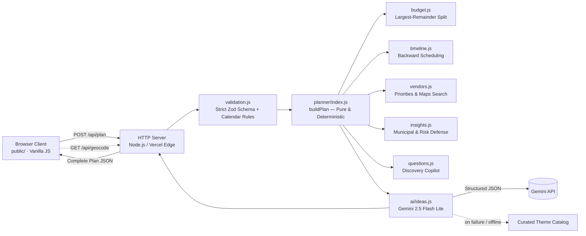

# Plan Together: GenAI Event Planning Assistant

[](https://github.com/seeramsujay/event-manager/actions/workflows/ci.yml)


[](https://event-manager-alpha-hazel.vercel.app)

An intelligent, accessible, zero-dependency assistant that helps people organize **weddings, birthdays, and community events**. You describe your event (date, guest count, budget, location, setting, style, priorities, and special considerations) and it synthesizes a production-grade plan grounded in deterministic arithmetic and fast GenAI creativity:

| Part of the plan | What you get |
|---|---|
| 🌟 **Landing page & smooth scroll** | Clean hero introduction with key value propositions and a keyboard/reduced-motion-aware smooth-scroll CTA to the planner form |
| 📍 **Smart location & local nuance** | Auto-prompts for geolocation on load, detects city via privacy-preserving reverse geocoding, and adapts plan to municipal curfews (10 PM sound rules), permits, and Google Maps vendor searches |
| 📊 **Interactive budget breakdown** | Adaptive SVG donut chart with synchronized hover inspection: donut center updates dynamically to amount & share while non-hovered categories smoothly dim |
| 💡 **Explain this plan** | Instant architectural breakdown explaining budget tier classifications, schedule compression factors, venue scale strategy, and core risk defenses |
| 🗓️ **Timeline & backward scheduling** | Milestones scheduled backwards from your event date with automatic proportional compression for short lead times |
| ✅ **Vendor checklist & local search** | Categorized vendors with priority badges, deadlines, local tips, and direct 1-click Google Maps discovery links |
| 🤖 **AI Agent Copilot & Parser** | Tailored discovery questions (food tastes, vibe, accessibility), one-click structured prompt export for ChatGPT/Claude/Gemini, and an intelligent answer parser that injects an **Agent Strategy Brief** into your plan |
| ⚠️ **Context-aware insights** | Proactive defenses for rushed schedules, tight budgets, municipal ordinances, vendor travel radii, weather contingencies, and accessibility |
| ✨ **Personalized ideas via Gemini 2.5** | Local seasonal menus, signature cocktail/mocktail tasting stations, and decor themes powered by **Google Gemini 2.5 Flash Lite** (with instant catalog fallback) |
| ♿ **Accessibility toolbar** | Expandable WCAG 2.2 AAA toolbar: font scaling (Large 118%), High Contrast mode, and forced reduced motion with zero-flash persistence |
| 📥 **Universal exports** | 1-click **Download Markdown** (`.md` with tables & checklists), **Download JSON** (full structured plan), and clean Print styling |

---

## Contents

1. [Live Demo](#live-demo)
2. [Chosen vertical](#chosen-vertical)
3. [Approach and architecture](#approach-and-architecture)
4. [Key features in action](#key-features-in-action)
5. [Getting started](#getting-started)
6. [Configuration](#configuration)
7. [Engineering quality: security, testing, accessibility](#engineering-quality)
8. [License](#license)

---

## Live Demo

🚀 **Production Deployment:** [https://event-manager-alpha-hazel.vercel.app](https://event-manager-alpha-hazel.vercel.app)

Try generating plans across different constraints:
- **Weddings:** 150 guests, \$35,000 budget, outdoor setting, photography priority.
- **Birthdays:** 10th birthday for kids, alcohol-free, low-waste, hybrid setting.
- **Community Festivals:** 500 attendees, municipal permits, safety/EMS thresholds.

---

## Chosen vertical

**Event Planning Assistant.** The target persona is a host or community organizer: a couple planning their wedding, a parent throwing a birthday party, or a neighborhood volunteer organizing a cultural festival. They are not professional event producers; they need realistic, enforceable guidance that respects their budget, timeline, and local regulations.

Three event verticals are deeply modeled:
1. **Weddings:** Long lead times (ideal 52 weeks), day-of coordination thresholds ($\ge 150$ guests), ceremony/reception transitions, officiants, florists, and photography.
2. **Birthdays:** Age-adaptive logic (kids $\le 12$ get kid-friendly supervision, nut-free snacks, and entertainer booking; adults get bartending and milestone tribute tasks for 21, 30, 40, etc.).
3. **Community Events:** Municipal authorities & permits ($\ge 300$ attendees), first aid & emergency services ($\ge 200$), crowd flow, outdoor canopy rentals, and waste/recycling stations.

---

## Approach and architecture

The application is architected around a strict principle: **Deterministic rules engine for critical math and logistics, GenAI for creativity and thematic nuance.**



### Deterministic Engine (`src/planner/`)
- **Budget Allocator:** Uses the **largest-remainder method** (Hamilton-Hare) so allocated cents always sum to $100\%$ of the budget without rounding drift. Category weights scale dynamically with user priorities ($\times 1.25$) and setting requirements.
- **Timeline Engine:** Calculates ideal lead dates backwards from the event date. If time is short, it executes proportional compression without inverted dates or past deadlines, automatically flagging overdue vendors as **Book now**.
- **Context Insights:** Automatically warns of municipal sound curfews (e.g. 10 PM residential noise limits), vendor travel radius charges, weather backup tents (+3% reserve), and required permits.
- **Discovery Questions:** Assembles targeted questions regarding guest food preferences, vibe/lighting desires, and accessibility needs.

### GenAI Creativity Layer (`src/ai/`)
- **Model:** Google **Gemini 2.5 Flash Lite** (`gemini-2.5-flash-lite`), providing sub-second structured JSON responses.
- **Grounding:** Injects the engine's computed budget tier, location, guest profile, setting, and key logistical risks into the prompt.
- **Resilience:** If no API key is supplied, or during rate limits or network failures, the planner automatically falls back to an extensive curated idea catalog with zero user disruption.

---

## Key features in action

### 1. Interactive Budget Donut & Synchronized Row Highlighting
- Visualizes spending distribution with an SVG donut chart.
- **Default center display:** Formatted total event budget.
- **Hover interaction:** Hovering any slice or table row highlights that category, displays its exact dollar amount, category title, and percentage in the donut center, while dimming all other rows and slices to 30% opacity.
- **Side share percentage:** Percentage numbers are cleanly positioned outside progress bars in a dedicated tabular column to prevent text clipping.

### 2. External AI Agent Copilot & Import Parser
- **📋 Copy Agent Prompt:** Generates an exhaustive prompt embedded with your event's specific budget tier, guest count, setting, and discovery questions.
- **📥 Import Agent Answers:** Paste the response from ChatGPT, Claude, or Gemini into the import drawer. The parser automatically structures the recommendations into an **Agent Strategy Brief** card embedded into the live plan and included in Markdown/JSON exports.

### 3. Native Export Capabilities
- **Download Markdown (`.md`):** Clean GitHub-flavored Markdown with formatted tables, task checklists (`- [ ]`), vendor booking dates, and AI ideas.
- **Download JSON:** Full structured data payload for integration into spreadsheets or external tools.
- **Print Optimization:** Specialized `@media print` stylesheet with dedicated header, footer, zero bar clipping, and page-break protection.

### 4. Privacy-Preserving Geolocation & Maps Discovery
- Automatically prompts for browser location on load if empty.
- Coordinates are rounded to 3 decimal places (~110m privacy buffer) before reverse geocoding through an in-memory cached proxy.
- Vendor checklist provides instant **Google Maps search links** configured for the selected vendor type and city.

---

## Getting started

Requires **Node.js 22.9+** and **pnpm**.

```bash
git clone https://github.com/seeramsujay/event-manager.git
cd event-manager
pnpm install
cp .env.example .env        # optional: add GEMINI_API_KEY for live AI ideas
pnpm start                  # → http://127.0.0.1:3000
```

Without an API key, the application operates fully in offline/curated mode.

| Command | What it does |
|---|---|
| `pnpm start` | Runs the server in production mode |
| `pnpm run dev` | Runs with auto-restart on file modifications |
| `pnpm test` | Runs the entire 622-test test suite |
| `pnpm run test:coverage` | Enforces 100% line coverage and high branch coverage |
| `pnpm run lint` | Runs ESLint across the codebase |
| `pnpm run check` | Runs lint + 100% coverage gate (identical to CI) |

---

## Configuration

All configuration is handled via environment variables validated at boot:

| Variable | Default | Purpose |
|---|---|---|
| `GEMINI_API_KEY` | (optional) | Google Gemini API key for real-time generative ideas |
| `GEMINI_MODEL` | `gemini-2.5-flash-lite` | Gemini model name |
| `PORT` | `3000` | HTTP listening port |
| `HOST` | `127.0.0.1` | Network interface (`0.0.0.0` in containers) |
| `RATE_LIMIT_PER_MINUTE` | `20` | Bounded sliding-window rate limit per client IP |
| `TRUST_PROXY` | `false` | Set to `true` behind reverse proxies (Vercel, Cloudflare, Nginx) |

---

## Engineering quality

### 🧪 622 Automated Tests (100% Line Coverage)
- **Property-based tests:** Over 2,000 randomized synthetic plans verified against invariant laws: zero budget drift, monotonic chronological timelines, and safe prompt bounds.
- **Browser DOM integration tests (jsdom):** Full UI audit covering accessibility attributes, focus traps, error summaries, interactive chart hover states, checklist persistence across storage, and export downloads.
- **Security & HTTP audit:** Verified against XSS injections, path traversal allowlists, HTTP header compliance (`Content-Security-Policy: default-src 'self'`), rate limiting, and request body streaming caps.

### ♿ Accessibility (WCAG 2.2 AA / AAA Compliant)
- **Accessibility Options Panel:** Zero-flash persistence for **Large Font Scaling (118%)**, **WCAG AAA High Contrast**, and **Forced Reduced Motion**.
- **Keyboard Navigation:** 100% operable with clear focus rings, skip-to-content links, and scoped ARIA live announcements.
- **Color Contrast:** Exceeds 4.5:1 in standard themes and 7:1 in High Contrast mode.

---

## License

[MIT](LICENSE)
