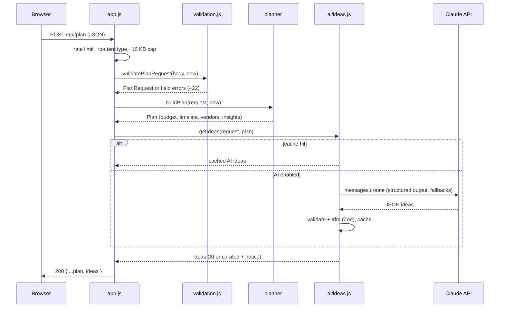

# Architecture

This document explains **why** the system is built the way it is. For usage, see the [README](../README.md); for the HTTP contract, see [API.md](API.md).

## Design principles

1. **Decisions are deterministic; creativity is generative.** Money, deadlines and safety tasks come from tested rules. The LLM writes ideas only, with the rules' output as grounding.
2. **Always useful.** Every AI failure mode falls back to a complete plan with curated ideas. The app works with no API key at all.
3. **Pure core, thin shell.** `buildPlan()` is a pure function of `(input, now)`. I/O (HTTP, the Claude call, the clock) lives at the edges and is injected, so tests need no network and no real time.
4. **Knowledge as data.** Budget splits, tasks, vendors and ideas live in `catalog.js`. Tuning the advice means editing data, not logic, and the catalog has its own integrity tests.
5. **Minimal surface.** Two runtime dependencies and no framework, build step or database.

## Request lifecycle

## The planning pipeline (`src/planner/`)

`buildPlan()` first derives a **context** that all rules share (`buildContext`):

| Context field | Derived from |
|---|---|
| `leadDays` | event date − today (UTC calendar days) |
| `leadRatio` | `min(1, leadDays / idealLeadDays)`; drives compression |
| `tier` | budget per guest in USD vs the profile's lean and premium thresholds |
| `isKids`, `kidFriendly`, `isMilestone` | birthday age and considerations |
| `dayOfWeek` | event date (UTC), for the Saturday-premium tip |

Then four independent steps run:

### Budget (`budget.js`)

1. Start from the profile's default weights (excluding contingency).
2. Add a rentals weight for outdoor (6%) or hybrid (3%) settings.
3. Multiply categories tied to the user's priorities by **1.25**.
4. Reserve contingency: 5% base, +3% outdoors, +2% when `leadRatio < 0.5`.
5. Normalize the other weights to fill `1 − contingency`.
6. Convert to whole currency units with the **largest-remainder method**, so the parts sum exactly to the total.

### Timeline (`timeline.js`)

Each task has an ideal `weeksBefore`. Pre-event tasks are scheduled at `weeksBefore × 7 × leadRatio` days before the event:

- With enough time (`leadRatio = 1`), the ideal schedule is used.
- With less time, every offset shrinks by the same factor. Order is preserved and no date falls before today, because `weeksBefore ≤ idealLeadWeeks`.
- Post-event tasks (negative weeks) are never compressed.
- Tasks due within 7 days are marked `urgent`.
- The phase comes from where the task sits in the ideal window: ≥50% is *Plan & book*, ≥15% is *Design & invite*, otherwise *Final details*.

### Vendors (`vendors.js`)

The priority starts from the vendor's base level, or a context rule (for example, a tent is *essential* outdoors), and moves up one step if the vendor serves a user priority. `bookBy` uses the same compression as the timeline; `bookNow` is set when the ideal booking window is longer than the time left. Optional vendors on lean budgets get a DIY nudge.

### Insights (`insights.js`)

An ordered list of small, independent rules. Each one inspects the context, budget and timeline and returns at most one insight. Results are sorted by severity, using a stable sort that keeps rule order within a level. Adding advice means adding one rule and one table-driven test.

## AI integration (`src/ai/ideas.js`)

| Decision | Rationale |
|---|---|
| Single call, structured outputs (`output_config.format` with a JSON schema) | Ideas are one deliverable, not an agent task; schema-constrained JSON removes parsing failures |
| `effort: "low"` on `claude-opus-5-5` | The heavy reasoning is already done by the rules engine; low effort keeps the interactive request fast. The model is configurable |
| `fallbacks: "default"` (beta `server-side-fallback-2026-07-01`) | A request declined by a safety classifier is re-run on a suitable model server-side. Only text after the last `fallback` block is parsed, because an earlier partial answer may precede it |
| Second validation with Zod | Defense in depth: rejects empty lists and blank strings; caps list sizes and string lengths before anything reaches the UI or cache |
| Prompt contains plan facts (tier, top categories, risks) | Keeps ideas consistent with the budget and the situation |
| Event name excluded from the prompt | It often contains people's names and adds nothing for idea generation |
| Free text fenced in `<vibe>`/`<notes>` with `<>` stripped | User text can't break out of its fence; the system prompt says fenced content is data |
| One-hour LRU cache, keyed on the request plus date-dependent plan facts | Repeated submissions cost nothing; the key changes when the day count or risks change |
| SDK timeout 30 s, one retry | Bounds the worst case below the browser's 75 s timeout |
| Every failure becomes curated ideas plus a `notice` | Users always get a plan; operators get a log line with the error class |

## Security model

| Layer | Controls |
|---|---|
| **Transport and headers** | CSP `default-src 'self'` (no inline scripts or styles, `object-src 'none'`, `base-uri 'none'`, `frame-ancestors 'none'`), `X-Frame-Options: DENY`, `nosniff`, `Referrer-Policy: no-referrer`, a Permissions-Policy, `Cross-Origin-Opener-Policy`, `Cache-Control: no-store` on the API |
| **Request handling** | The path is parsed without `new URL()` (which can throw on raw targets); every error is caught and returned as a generic message; the 16 KB limit is enforced while streaming; media type parsed per RFC 9110 |
| **Input** | Strict Zod schema with unknown keys rejected; typed numbers, enums and bounded lengths; control characters stripped; real calendar dates only |
| **Abuse and cost** | Fixed-window rate limit per client. Memory is bounded (`maxKeys`; expired windows dropped in O(1) amortized), IPv6 is grouped by /64, and behind a trusted proxy only the proxy-appended right-most `X-Forwarded-For` entry counts |
| **Output** | The frontend renders with `textContent` only; CSS widths are set via CSSOM, which the CSP allows, never with `style=""` |
| **Secrets** | The API key lives in server env only; it is never logged (tested) and never sent to the browser |
| **Static files** | A fixed allowlist, loaded into memory at startup |

## Frontend (`public/`)

Vanilla JS with no framework and no build step. Key behaviors:

- **Rendering**: an `el()` helper builds DOM nodes, with text set only through `textContent`.
- **Validation**: client-side checks mirror the server for instant feedback, and the server stays authoritative; its `422` details are mapped back onto fields.
- **Focus management**: the first invalid field gets focus; the results heading gets focus on success; the submit button uses `aria-disabled` while busy, so focus is never dropped.
- **Stale data**: a failed resubmit hides the previous plan so it can't be mistaken for the new one.
- **Persistence**: checklist ticks are stored in `localStorage` under an FNV-1a fingerprint of the plan inputs.
- **Resilience**: a 75 s request timeout, and distinct messages for network failures, timeouts and server errors.

## Testing strategy

| Level | Technique |
|---|---|
| Rules | Table-driven tests: each rule triggered and not triggered, at exact thresholds (149 vs 150 guests, age 12 vs 13, …) |
| Invariants | Property-based: 2,000 random valid requests (seeded PRNG, so failures are reproducible) checked against every plan invariant |
| Data | Catalog integrity: shares sum to 1, ids unique, categories known, rule functions return valid values |
| AI | A fake client returns each response shape (success, fallback blocks, refusals, truncation, bad JSON, empty lists, SDK error classes) |
| HTTP | A real server on a random port, plus raw-socket requests for targets `fetch()` won't send |
| UI | The real `index.html` and `app.js` in jsdom: user flows, failure modes and an automated accessibility audit |
| Process | `server.js` spawned as a child process: startup modes, config errors, signal handling |

Coverage gates (98% lines, 95% branches, 98% functions) and ESLint run in CI on Node 22 and 24.

## Scaling notes

The rate limiter and cache are per-process memory, which is right for a single instance. To scale horizontally, move both behind an interface backed by Redis (the classes already expose `check` and `get`/`set`). The planner is stateless and scales without changes.
